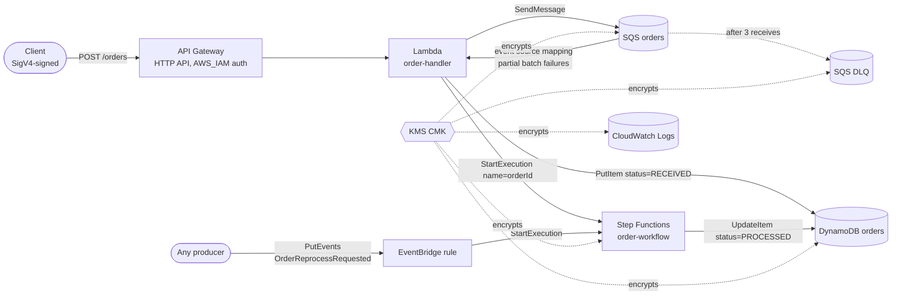

# serverless-event-pipeline

An order-ingestion pipeline on AWS serverless, provisioned with Terraform. GitLab CI/CD lints, tests, scans, plans, and applies it.

## Architecture



**Flow**

1. `POST /orders` hits the HTTP API. The route uses `AWS_IAM` authorization, so only signed requests from principals with `execute-api:Invoke` get through.
2. The Lambda validates the body (`customerId`, `amount` > 0 and ≤ 1,000,000, optional `orderId` and `currency`). It enqueues the order and returns `202 {"orderId": ..., "status": "ACCEPTED"}`. Bad JSON gets `400`, a validation failure gets `422`, and both use the `{"error": {"code", "message"}}` shape.
3. SQS invokes the same Lambda in batches. For each message it does two things:
   - `PutItem` with `attribute_not_exists(orderId)`, so a redelivered message never overwrites an order.
   - `StartExecution` with `name = orderId`, so a retry cannot start a second workflow.
   Failed records are returned in `batchItemFailures`. Only those records are retried, and after 3 receives they move to the DLQ.
4. The Step Functions workflow checks its input and then calls DynamoDB `UpdateItem` directly (no Lambda in between) to set `status=PROCESSED`, `processedAt`, and `processedBy`. Throttling errors are retried with jitter. If the order doesn't exist, the run ends in `OrderNotFound`.
5. **EventBridge** has a custom-event rule on the default bus. A `serverless-event-pipeline.orders` / `OrderReprocessRequested` event with `detail.orderId` restarts the workflow for an existing order. I picked a custom event over a schedule because the workflow acts on a single order, and a cron trigger would have no order to pass in.

   ```bash
   aws events put-events --entries '[{"Source":"serverless-event-pipeline.orders","DetailType":"OrderReprocessRequested","Detail":"{\"orderId\":\"order-001\"}"}]'
   ```

**Security**

- **Encryption at rest:** one customer-managed KMS key with rotation enabled. It covers both queues, DynamoDB, Lambda environment variables, Step Functions execution data, and every log group.
- **Encryption in transit:** the queue policies deny any request that isn't TLS. All AWS APIs and API Gateway are HTTPS-only.
- **IAM:** each service has its own role (Lambda, Step Functions, EventBridge), scoped to exact ARNs and protected by `aws:SourceAccount` / `aws:SourceArn` confused-deputy conditions. Wildcard resources appear in two places only, and AWS requires both: X-Ray trace writes, and Step Functions log delivery. Neither supports resource-level permissions.
- **Observability:** X-Ray tracing is on for both Lambda and Step Functions. API access logs, Lambda logs, and workflow logs are kept for 365 days. Lambda writes structured JSON log lines (`order_enqueued`, `order_processed`, `order_rejected`).

## Repository layout

```
.
├── .gitlab-ci.yml                 # lint -> test -> checkov -> plan -> apply
├── .checkov.yml                   # Checkov config + justified skips
├── pyproject.toml                 # ruff + pytest config
├── requirements-dev.txt           # pinned test/lint deps
├── bootstrap/main.tf              # one-time: state bucket, GitLab OIDC provider, deploy role
├── src/
│   ├── handler.py                 # Lambda (API Gateway + SQS entry points)
│   └── requirements.txt           # pinned runtime deps (boto3 comes with the runtime)
├── terraform/
│   ├── versions.tf                # Terraform/provider versions, S3 backend, default tags
│   ├── variables.tf  main.tf  outputs.tf
│   ├── kms.tf  sqs.tf  dynamodb.tf  lambda.tf
│   ├── apigateway.tf  stepfunctions.tf  eventbridge.tf  iam.tf
│   └── statemachine/order_workflow.asl.json
└── tests/
    ├── conftest.py                # moto-backed DynamoDB, SQS, Step Functions
    ├── test_lambda.py             # handler behaviour
    └── test_state_machine_definition.py  # ASL static checks
```

## CI/CD stages

| Stage | Job | What it does | Runs on |
|---|---|---|---|
| lint | `terraform_lint` | `terraform fmt -check`, `init -backend=false`, `validate` | every pipeline |
| lint | `python_lint` | `ruff check` + `ruff format --check` | every pipeline |
| test | `unit_tests` | pytest + moto, JUnit and Cobertura reports, fails under 90% coverage | every pipeline |
| checkov | `checkov` | Scans `terraform/`. With no `PRISMA_API_KEY`, any failed check fails the job (a superset of HIGH/CRITICAL, since free Checkov has no severity data). With the key set, only HIGH and CRITICAL fail it. | every pipeline |
| plan | `terraform_plan` | `terraform plan -out=tfplan`. The plan file, `plan.txt`, and the Lambda zip are saved as developer-only artifacts. | MRs, external PRs, default branch |
| apply | `terraform_apply` | `terraform apply tfplan`, using exactly the reviewed plan | default branch, **manual** |

Plan and apply share a `resource_group`, so two runs never touch the same state at once. State lives in S3, with native lockfile locking (`use_lockfile`, which needs Terraform 1.10 or later).

## Setup

### 1. AWS prerequisites (one time)

You need the AWS CLI with an admin profile and Terraform 1.10 or later.

```bash
cd bootstrap
terraform init
terraform apply -var="gitlab_project_path=kem-logistic-and-solutions/serverless-event-pipeline"
```

Note the two outputs: `state_bucket` and `deploy_role_arn`. Bootstrap state is stored locally, so keep `bootstrap/terraform.tfstate` safe. It is gitignored.

If the account already has a `https://gitlab.com` OIDC provider, import it first:
`terraform import aws_iam_openid_connect_provider.gitlab arn:aws:iam::<ACCOUNT_ID>:oidc-provider/gitlab.com`.

### 2. Repository hosting

You have two options:

- **Directly on GitLab:** push this repo to the GitLab project. Pipelines run on every push.
- **On GitHub, with CI on GitLab:** create an empty GitHub repo named `serverless-event-pipeline` and push there. Then in GitLab go to **New project → Run CI/CD for external repository → GitHub**, authorize, and pick the repo. GitLab mirrors it and runs `.gitlab-ci.yml` on pushes and pull requests (`external_pull_request_event`).

### 3. CI/CD variables

Set these under GitLab **Settings → CI/CD → Variables**:

| Variable | Required | Value | Flags |
|---|---|---|---|
| `TF_STATE_BUCKET` | yes | `state_bucket` output | — |
| `AWS_ROLE_ARN` | preferred | `deploy_role_arn` output (OIDC, no static keys) | — |
| `AWS_ACCESS_KEY_ID` | fallback only | IAM user key | Masked |
| `AWS_SECRET_ACCESS_KEY` | fallback only | IAM user secret | Masked, Hidden |
| `AWS_REGION` | no | default `us-east-1` | — |
| `TF_VAR_environment` | no | `dev` / `staging` / `prod` | — |
| `TF_STATE_KEY` | no | default `serverless-event-pipeline/<env>.tfstate` | — |
| `PRISMA_API_KEY` | no | enables severity-based Checkov gating | Masked |

If you mark the variables **Protected**, they are only exposed on protected branches. In that case MR plans will fail for lack of credentials. Either leave them unprotected and rely on the OIDC trust policy plus the manual apply gate, or create a separate read-only plan role.

When `AWS_ROLE_ARN` is set, the pipeline writes the GitLab `id_token` (audience `sts.amazonaws.com`) to a temp file and exports `AWS_WEB_IDENTITY_TOKEN_FILE`. The Terraform AWS provider and S3 backend then call `AssumeRoleWithWebIdentity` themselves, so no keys are ever stored.

### 4. First pipeline run

1. Push to `main`. Lint, test, checkov, and plan run automatically.
2. Open the `terraform_plan` job and read the `plan.txt` artifact.
3. Click ▶ on `terraform_apply`.
4. Run a smoke test. Calls must be SigV4-signed, for example with [awscurl](https://github.com/okigan/awscurl):
   ```bash
   awscurl --service execute-api -X POST "$(terraform -chdir=terraform output -raw api_endpoint)/orders" \
     -d '{"customerId":"cust-42","amount":19.99}'
   aws dynamodb scan --table-name serverless-event-pipeline-dev-orders
   ```
   The item should show `status` = `PROCESSED` within a few seconds.

## Local development

```bash
python -m venv .venv && . .venv/bin/activate
pip install -r requirements-dev.txt
ruff check src tests && ruff format --check src tests
pytest --cov=src

cd terraform
terraform fmt -check -recursive
terraform init -backend=false && terraform validate
checkov --config-file ../.checkov.yml -d .
```

## Assumptions

- Lambda runs Python 3.12 on arm64, one minor version above the 3.11 minimum, and arm64 is cheaper per GB-second.
- The Lambda zip contains only `handler.py`, because boto3 is supplied by the runtime.
- Terraform `>= 1.10` is required for S3 native locking. That still satisfies "1.5+". CI pins `hashicorp/terraform:1.10.5`.
- Checkov skips, each justified in `.checkov.yml` or inline:
  - `CKV_AWS_117`: Lambda in a VPC adds no value here.
  - `CKV_AWS_272`: code signing is listed as a next step.
  - Three key-policy false positives: a `"*"` resource in a key policy means "this key".

## Next steps

- CloudWatch alarms on DLQ depth (`ApproximateNumberOfMessagesVisible > 0`), on Lambda errors and throttles, and on Step Functions `ExecutionsFailed`, sent to SNS.
- A DLQ redrive runbook: `aws sqs start-message-move-task --source-arn <dlq-arn>`.
- Lambda code signing with AWS Signer, which would retire `CKV_AWS_272`.
- Separate plan (read-only) and apply roles, with the apply role trusted only for `ref:main` and protected environments.
- Cost: on-demand DynamoDB and HTTP API suit spiky, low traffic. Revisit provisioned capacity once traffic is steady. Shorter log retention cuts cost outside prod.
